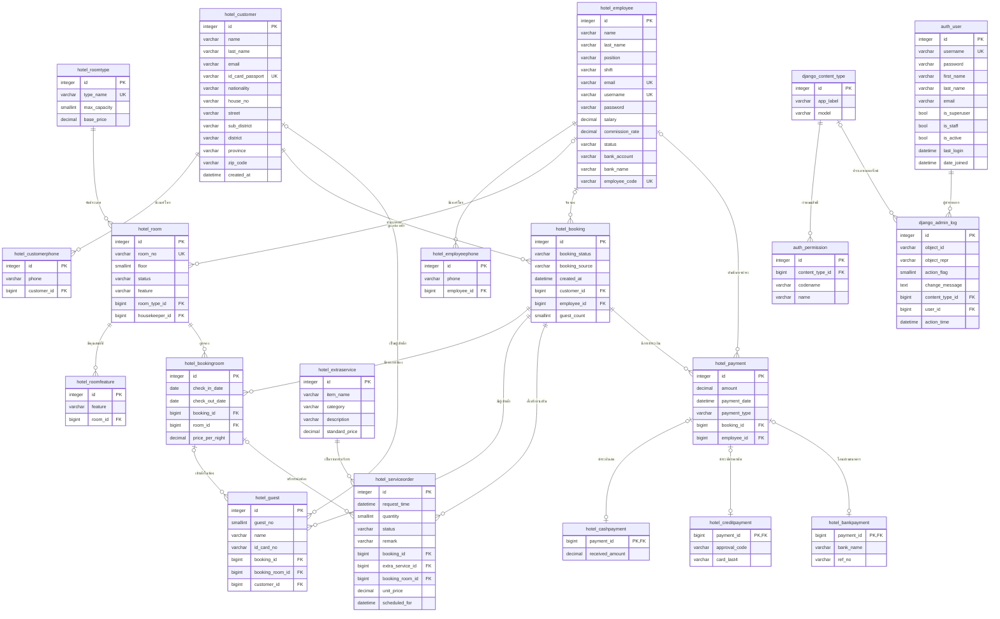

# แผนภาพความสัมพันธ์ฐานข้อมูลระบบโรงแรม (ER Diagram)

แผนภาพนี้สร้างจากไฟล์ [db.sqlite3](db.sqlite3) และแสดงความสัมพันธ์หลักของระบบโรงแรม



# โครงสร้างฐานข้อมูลของระบบโรงแรม

เอกสารนี้สร้างจากไฟล์ฐานข้อมูล [db.sqlite3](db.sqlite3) ซึ่งเป็น SQLite 3 และสรุปรูปแบบตาราง ข้อมูลอ้างอิง ข้อจำกัด และจำนวนข้อมูล ณ วันที่ตรวจสอบ

## ภาพรวม

- ระบบ: Django
- ฐานข้อมูล: SQLite
- ตารางหลักของระบบโรงแรม: 16 ตาราง
- ตาราง Django สำหรับสิทธิ์ผู้ใช้ เซสชัน และประวัติการทำงาน
- ไม่มีตารางประวัติ (historical/audit) ของโมเดล hotel ในฐานข้อมูล
- ระบบใช้รูปแบบการชำระเงินแบบหลายตาราง: `hotel_payment` เป็นตารางหลัก รองรับแยกย่อยเป็น Cash, Credit และ Bank

## แผนภาพความสัมพันธ์ (ERD)

```mermaid
erDiagram
    AUTH_USER {
        int id PK
        string username UK
        string password
        bool is_superuser
        bool is_staff
        bool is_active
    }

    DJANGO_CONTENT_TYPE {
        int id PK
        string app_label
        string model
    }

    AUTH_PERMISSION {
        int id PK
        int content_type_id FK
        string codename
        string name
    }

    DJANGO_ADMIN_LOG {
        int id PK
        int content_type_id FK
        int user_id FK
        string object_repr
        datetime action_time
    }

    CUSTOMER {
        int id PK
        string name
        string last_name
        string id_card_passport UK
        string nationality
    }

    CUSTOMERPHONE {
        int id PK
        string phone
        bigint customer_id FK
    }

    EMPLOYEE {
        int id PK
        string name
        string last_name
        string position
        string username UK
        string email UK
        decimal salary
        string status
    }

    EMPLOYEEPHONE {
        int id PK
        string phone
        bigint employee_id FK
    }

    ROOMTYPE {
        int id PK
        string type_name UK
        smallint max_capacity
        decimal base_price
    }

    ROOM {
        int id PK
        string room_no UK
        int floor
        string status
        bigint room_type_id FK
        bigint housekeeper_id FK
    }

    ROOMFEATURE {
        int id PK
        string feature
        bigint room_id FK
    }

    BOOKING {
        int id PK
        bigint customer_id FK
        bigint employee_id FK
        string booking_status
        string booking_source
        int guest_count
        datetime created_at
    }

    BOOKINGROOM {
        int id PK
        bigint booking_id FK
        bigint room_id FK
        date check_in_date
        date check_out_date
        decimal price_per_night
    }

    GUEST {
        int id PK
        bigint booking_id FK
        bigint booking_room_id FK
        bigint customer_id FK
        int guest_no
        string name
        string id_card_no
    }

    EXTRASERVICE {
        int id PK
        string item_name
        string category
        string description
        decimal standard_price
    }

    SERVICEORDER {
        int id PK
        bigint booking_id FK
        bigint extra_service_id FK
        bigint booking_room_id FK
        int quantity
        decimal unit_price
        string status
    }

    PAYMENT {
        int id PK
        bigint booking_id FK
        bigint employee_id FK
        decimal amount
        datetime payment_date
        string payment_type
    }

    CASHPAYMENT {
        bigint payment_id PK_FK
        decimal received_amount
    }

    CREDITPAYMENT {
        bigint payment_id PK_FK
        string approval_code
        string card_last4
    }

    BANKPAYMENT {
        bigint payment_id PK_FK
        string bank_name
        string ref_no
    }

    DJANGO_CONTENT_TYPE ||--o{ AUTH_PERMISSION : "กำหนดสิทธิ์"
    AUTH_USER ||--o{ DJANGO_ADMIN_LOG : "บันทึกโดย"
    CUSTOMER ||--o{ CUSTOMERPHONE : "มีเบอร์"
    CUSTOMER ||--o{ BOOKING : "จอง"
    EMPLOYEE ||--o{ EMPLOYEEPHONE : "มีเบอร์"
    EMPLOYEE ||--o{ ROOM : "ดูแลห้อง"
    EMPLOYEE ||--o{ BOOKING : "รับการจอง"
    EMPLOYEE ||--o{ PAYMENT : "บันทึกการชำระ"
    ROOMTYPE ||--o{ ROOM : "จัดประเภท"
    ROOM ||--o{ ROOMFEATURE : "มีสิ่งอำนวยความสะดวก"
    BOOKING ||--o{ BOOKINGROOM : "เลือกห้อง"
    ROOM ||--o{ BOOKINGROOM : "ถูกจอง"
    BOOKING ||--o{ GUEST : "มีผู้เข้าพัก"
    BOOKINGROOM ||--o{ GUEST : "พักในห้อง"
    CUSTOMER ||--o{ GUEST : "เป็นผู้เข้าพัก"
    BOOKING ||--o{ SERVICEORDER : "สั่งบริการ"
    EXTRASERVICE ||--o{ SERVICEORDER : "ถูกสั่ง"
    BOOKINGROOM ||--o{ SERVICEORDER : "บริการต่อห้อง"
    BOOKING ||--o{ PAYMENT : "ชำระ"
    PAYMENT ||--o| CASHPAYMENT : "เงินสด"
    PAYMENT ||--o| CREDITPAYMENT : "บัตรเครดิต"
    PAYMENT ||--o| BANKPAYMENT : "ธนาคาร"
```

> ตาราง `django_admin_log` ถูกอ้างอิงใน ERD แต่ไม่ได้แสดงรายละเอียดคอลัมน์ทั้งหมด

## ตารางข้อมูลธุรกิจหลัก

### `hotel_customer` — ข้อมูลลูกค้า (4 แถว)

| คอลัมน์ | ประเภท | เป็นค่าว่าง | ความหมาย / ข้อจำกัด |
|---|---|---:|---|
| `id` | INTEGER PK | ไม่ | รหัสลูกค้าอัตโนมัติ |
| `name` | varchar(100) | ไม่ | ชื่อ |
| `last_name` | varchar(100) | ไม่ | นามสกุล |
| `email` | varchar(100) | ได้ | อีเมล |
| `id_card_passport` | varchar(20) | ไม่ | เลขบัตรประชาชน/หนังสือเดินทาง ไม่ซ้ำ |
| `nationality` | varchar(50) | ไม่ | สัญชาติ |
| `house_no` | varchar(20) | ได้ | บ้านเลขที่ |
| `street` | varchar(100) | ได้ | ถนน |
| `sub_district` | varchar(50) | ได้ | ตำบล/แขวง |
| `district` | varchar(50) | ได้ | อำเภอ/เขต |
| `province` | varchar(50) | ได้ | จังหวัด |
| `zip_code` | varchar(10) | ได้ | รหัสไปรษณีย์ |
| `created_at` | datetime | ไม่ | วันเวลาที่สร้างข้อมูล |

### `hotel_customerphone` — เบอร์โทรลูกค้า (3 แถว)

| คอลัมน์ | ประเภท | เป็นค่าว่าง | ความหมาย / ข้อจำกัด |
|---|---|---:|---|
| `id` | INTEGER PK | ไม่ | รหัส |
| `phone` | varchar(20) | ไม่ | หมายเลขโทรศัพท์ |
| `customer_id` | bigint FK | ไม่ | อ้างอิง `hotel_customer.id` |

ข้อจำกัด: `UNIQUE(customer_id, phone)` ห้ามมีเบอร์ซ้ำสำหรับลูกค้าเดียวกัน

### `hotel_employee` — ข้อมูลพนักงาน (13 แถว)

| คอลัมน์ | ประเภท | เป็นค่าว่าง | ความหมาย / ข้อจำกัด |
|---|---|---:|---|
| `id` | INTEGER PK | ไม่ | รหัสพนักงาน |
| `name` | varchar(100) | ไม่ | ชื่อ |
| `last_name` | varchar(100) | ไม่ | นามสกุล |
| `position` | varchar(100) | ไม่ | ตำแหน่ง |
| `shift` | varchar(50) | ไม่ | รอบทำงาน |
| `email` | varchar(100) | ได้ | อีเมล ไม่ซ้ำ |
| `username` | varchar(50) | ไม่ | ชื่อผู้ใช้ ไม่ซ้ำ |
| `password` | varchar(255) | ไม่ | รหัสผ่านที่เก็บในฐานข้อมูล |
| `salary` | decimal | ไม่ | เงินเดือน |
| `commission_rate` | decimal | ไม่ | อัตราคอมมิชชัน |
| `status` | varchar(10) | ไม่ | สถานะพนักงาน |
| `bank_account` | varchar(32) | ไม่ | เลขบัญชีธนาคาร |
| `bank_name` | varchar(100) | ไม่ | ชื่อธนาคาร |
| `employee_code` | varchar(20) | ได้ | รหัสพนักงาน ไม่ซ้ำ |

### `hotel_employeephone` — เบอร์โทรพนักงาน (13 แถว)

| คอลัมน์ | ประเภท | เป็นค่าว่าง | ความหมาย / ข้อจำกัด |
|---|---|---:|---|
| `id` | INTEGER PK | ไม่ | รหัส |
| `phone` | varchar(20) | ไม่ | หมายเลขโทรศัพท์ |
| `employee_id` | bigint FK | ไม่ | อ้างอิง `hotel_employee.id` |

ข้อจำกัด: `UNIQUE(employee_id, phone)`

### `hotel_roomtype` — ประเภทห้องพัก (3 แถว)

| คอลัมน์ | ประเภท | เป็นค่าว่าง | ความหมาย / ข้อจำกัด |
|---|---|---:|---|
| `id` | INTEGER PK | ไม่ | รหัสประเภทห้อง |
| `type_name` | varchar(50) | ไม่ | ชื่อประเภทห้อง ไม่ซ้ำ |
| `max_capacity` | smallint unsigned | ไม่ | จำนวนผู้เข้าพักสูงสุด ต้อง `>= 0` |
| `base_price` | decimal | ไม่ | ราคาพื้นฐาน |

### `hotel_room` — ห้องพัก (50 แถว)

| คอลัมน์ | ประเภท | เป็นค่าว่าง | ความหมาย / ข้อจำกัด |
|---|---|---:|---|
| `id` | INTEGER PK | ไม่ | รหัสห้อง |
| `room_no` | varchar(10) | ไม่ | หมายเลขห้อง ไม่ซ้ำ |
| `floor` | smallint unsigned | ไม่ | ชั้น ต้อง `>= 0` |
| `status` | varchar(15) | ไม่ | สถานะห้อง |
| `feature` | varchar(200) | ไม่ | รายละเอียดคุณสมบัติหลัก |
| `room_type_id` | bigint FK | ไม่ | อ้างอิง `hotel_roomtype.id` |
| `housekeeper_id` | bigint FK | ได้ | พนักงานแม่บ้านผู้ดูแล อ้างอิง `hotel_employee.id` |

### `hotel_roomfeature` — คุณสมบัติเฉพาะของห้อง (50 แถว)

| คอลัมน์ | ประเภท | เป็นค่าว่าง | ความหมาย / ข้อจำกัด |
|---|---|---:|---|
| `id` | INTEGER PK | ไม่ | รหัส |
| `feature` | varchar(50) | ไม่ | ชื่อคุณสมบัติ |
| `room_id` | bigint FK | ไม่ | อ้างอิง `hotel_room.id` |

ข้อจำกัด: `UNIQUE(room_id, feature)`

### `hotel_booking` — การจอง (3 แถว)

| คอลัมน์ | ประเภท | เป็นค่าว่าง | ความหมาย / ข้อจำกัด |
|---|---|---:|---|
| `id` | INTEGER PK | ไม่ | รหัสการจอง |
| `booking_status` | varchar(15) | ไม่ | สถานะการจอง |
| `booking_source` | varchar(10) | ไม่ | ช่องทางการจอง |
| `created_at` | datetime | ไม่ | เวลาที่สร้างการจอง |
| `customer_id` | bigint FK | ไม่ | ลูกค้าที่จอง |
| `employee_id` | bigint FK | ได้ | พนักงานผู้รับการจอง |
| `guest_count` | smallint unsigned | ไม่ | จำนวนผู้เข้าพัก ต้องอยู่ระหว่าง `>= 1` และเช็ก constraint รวมในฐานข้อมูล |

ข้อจำกัดเฉพาะ: `guest_count >= 1`

### `hotel_bookingroom` — ห้องที่อยู่ในแต่ละการจอง (3 แถว)

| คอลัมน์ | ประเภท | เป็นค่าว่าง | ความหมาย / ข้อจำกัด |
|---|---|---:|---|
| `id` | INTEGER PK | ไม่ | รหัสรายการ |
| `booking_id` | bigint FK | ไม่ | อ้างอิง `hotel_booking.id` |
| `room_id` | bigint FK | ไม่ | อ้างอิง `hotel_room.id` |
| `check_in_date` | date | ไม่ | วันเช็กอิน |
| `check_out_date` | date | ไม่ | วันเช็กเอาต์ |
| `price_per_night` | decimal | ไม่ | ราคาต่อคืน ต้อง `>= 0` |

ข้อจำกัด:

- `UNIQUE(booking_id, room_id)` ห้ามเลือกห้องเดิมซ้ำในการจองเดียวกัน
- `check_out_date > check_in_date`
- `price_per_night >= 0`

### `hotel_guest` — ผู้เข้าพัก (4 แถว)

| คอลัมน์ | ประเภท | เป็นค่าว่าง | ความหมาย / ข้อจำกัด |
|---|---|---:|---|
| `id` | INTEGER PK | ไม่ | รหัสผู้เข้าพัก |
| `guest_no` | smallint unsigned | ไม่ | ลำดับผู้เข้าพัก ต้อง `>= 0` |
| `name` | varchar(150) | ไม่ | ชื่อผู้เข้าพัก |
| `id_card_no` | varchar(30) | ไม่ | เลขบัตรประชาชน/เอกสาร |
| `booking_id` | bigint FK | ไม่ | อ้างอิง `hotel_booking.id` |
| `booking_room_id` | bigint FK | ได้ | อ้างอิง `hotel_bookingroom.id` |
| `customer_id` | bigint FK | ได้ | อ้างอิง `hotel_customer.id` หากผู้เข้าพักเป็นลูกค้า |

ข้อจำกัด:

- `UNIQUE(booking_id, guest_no)`
- `UNIQUE(booking_id, customer_id)`

### `hotel_extraservice` — บริการเสริม (3 แถว)

| คอลัมน์ | ประเภท | เป็นค่าว่าง | ความหมาย / ข้อจำกัด |
|---|---|---:|---|
| `id` | INTEGER PK | ไม่ | รหัสบริการ |
| `item_name` | varchar(100) | ไม่ | ชื่อรายการ |
| `category` | varchar(100) | ไม่ | หมวดหมู่ |
| `description` | varchar(255) | ไม่ | รายละเอียด |
| `standard_price` | decimal | ไม่ | ราคามาตรฐาน |

### `hotel_serviceorder` — คำสั่งบริการเสริม (6 แถว)

| คอลัมน์ | ประเภท | เป็นค่าว่าง | ความหมาย / ข้อจำกัด |
|---|---|---:|---|
| `id` | INTEGER PK | ไม่ | รหัสคำสั่ง |
| `request_time` | datetime | ไม่ | เวลาที่สั่ง |
| `quantity` | smallint unsigned | ไม่ | จำนวน ต้อง `> 0` |
| `status` | varchar(10) | ไม่ | สถานะคำสั่ง |
| `remark` | varchar(255) | ไม่ | หมายเหตุ |
| `booking_id` | bigint FK | ไม่ | อ้างอิง `hotel_booking.id` |
| `extra_service_id` | bigint FK | ไม่ | อ้างอิง `hotel_extraservice.id` |
| `booking_room_id` | bigint FK | ได้ | อ้างอิงห้องในการจอง |
| `unit_price` | decimal | ไม่ | ราคาต่อหน่วย ต้อง `>= 0` |
| `scheduled_for` | datetime | ได้ | เวลาให้บริการตามกำหนด |

### `hotel_payment` — การชำระเงินหลัก (1 แถว)

| คอลัมน์ | ประเภท | เป็นค่าว่าง | ความหมาย / ข้อจำกัด |
|---|---|---:|---|
| `id` | INTEGER PK | ไม่ | รหัสการชำระ |
| `amount` | decimal | ไม่ | จำนวนเงิน |
| `payment_date` | datetime | ไม่ | วันเวลาชำระ |
| `payment_type` | varchar(10) | ไม่ | ประเภทการชำระ |
| `booking_id` | bigint FK | ไม่ | อ้างอิง `hotel_booking.id` |
| `employee_id` | bigint FK | ได้ | พนักงานผู้บันทึกการชำระ |

### ตารางรายละเอียดการชำระเงิน

| ตาราง | จำนวนแถว | คอลัมน์หลัก | ความหมาย |
|---|---:|---|---|
| `hotel_cashpayment` | 1 | `payment_id` PK/FK, `received_amount` | รายละเอียดเงินสด |
| `hotel_creditpayment` | 0 | `payment_id` PK/FK, `approval_code`, `card_last4` | รายละเอียดบัตรเครดิต |
| `hotel_bankpayment` | 0 | `payment_id` PK/FK, `bank_name`, `ref_no` | รายละเอียดโอนผ่านธนาคาร |

ทั้งสามตารางย่อยอ้างอิง `hotel_payment.id` แบบ primary key/foreign key เดียวกัน

## ความสัมพันธ์และพฤติกรรมเชื่อมโยง

| ความสัมพันธ์ | จากคอลัมน์ | ไปยังตาราง | ประเภท |
|---|---|---|---|
| เบอร์ลูกค้า | `hotel_customerphone.customer_id` | `hotel_customer.id` | Many-to-One |
| เบอร์พนักงาน | `hotel_employeephone.employee_id` | `hotel_employee.id` | Many-to-One |
| ห้องพัก | `hotel_room.room_type_id` | `hotel_roomtype.id` | Many-to-One |
| ผู้ดูแลห้อง | `hotel_room.housekeeper_id` | `hotel_employee.id` | Many-to-One / Nullable |
| คุณสมบัติห้อง | `hotel_roomfeature.room_id` | `hotel_room.id` | Many-to-One |
| การจอง | `hotel_booking.customer_id` | `hotel_customer.id` | Many-to-One |
| ผู้รับจอง | `hotel_booking.employee_id` | `hotel_employee.id` | Many-to-One / Nullable |
| ห้องในการจอง | `hotel_bookingroom.booking_id` | `hotel_booking.id` | Many-to-One |
| ห้องในการจอง | `hotel_bookingroom.room_id` | `hotel_room.id` | Many-to-One |
| ผู้เข้าพัก | `hotel_guest.booking_id` | `hotel_booking.id` | Many-to-One |
| ผู้เข้าพักต่อห้อง | `hotel_guest.booking_room_id` | `hotel_bookingroom.id` | Many-to-One / Nullable |
| ลูกค้าผู้เข้าพัก | `hotel_guest.customer_id` | `hotel_customer.id` | Many-to-One / Nullable |
| คำสั่งบริการ | `hotel_serviceorder.booking_id` | `hotel_booking.id` | Many-to-One |
| บริการที่สั่ง | `hotel_serviceorder.extra_service_id` | `hotel_extraservice.id` | Many-to-One |
| ห้องที่สั่งบริการ | `hotel_serviceorder.booking_room_id` | `hotel_bookingroom.id` | Many-to-One / Nullable |
| การชำระเงิน | `hotel_payment.booking_id` | `hotel_booking.id` | Many-to-One |
| ผู้บันทึกการชำระ | `hotel_payment.employee_id` | `hotel_employee.id` | Many-to-One / Nullable |

## ตารางระบบ Django

| ตาราง | จำนวนแถว | หน้าที่ |
|---|---:|---|
| `auth_user` | 1 | ผู้ใช้และบัญชีผู้ดูแล |
| `auth_group` | 0 | กลุ่มสิทธิ์ |
| `auth_permission` | 88 | สิทธิ์การเข้าถึงตาม content type |
| `auth_user_groups` | 0 | เชื่อมผู้ใช้กับกลุ่ม |
| `auth_user_user_permissions` | 0 | สิทธิ์เฉพาะของผู้ใช้ |
| `auth_group_permissions` | 0 | สิทธิ์ของกลุ่ม |
| `django_content_type` | 22 | จับคู่โมเดลกับ app |
| `django_admin_log` | 5 | ประวัติการทำงานใน Django Admin |
| `django_session` | 1 | ข้อมูลเซสชันผู้ใช้ |
| `django_migrations` | 26 | บันทึก migration ที่นำไปใช้ |

### คอลัมน์สำคัญของตารางระบบ Django

#### `auth_user`

`id`, `password`, `last_login`, `is_superuser`, `username`, `last_name`, `email`, `is_staff`, `is_active`, `date_joined`, `first_name`

#### `django_admin_log`

`id`, `object_id`, `object_repr`, `action_flag`, `change_message`, `content_type_id`, `user_id`, `action_time`

#### `django_content_type`

`id`, `app_label`, `model` โดยมีข้อจำกัด `UNIQUE(app_label, model)`

#### `django_session`

`session_key` เป็น primary key, `session_data`, `expire_date`

#### `django_migrations`

`id`, `app`, `name`, `applied`

## ข้อสังเกตสำคัญสำหรับนักพัฒนา

- การเชื่อมโยงทั้งหมดในไฟล์ SQLite นี้ใช้ foreign key และ `DEFERRABLE INITIALLY DEFERRED`
- ตารางย่อยของการชำระเงินเป็นรูปแบบ multi-table inheritance ที่ primary key ของตารางย่อยเป็น foreign key ไปยัง `hotel_payment.id`
- ตาราง booking room มี constraint ไม่ให้เช็กเอาต์ก่อนเช็กอินและไม่ให้จองห้องเดิมซ้ำใน booking เดียวกัน
- เบอร์โทรลูกค้าและพนักงานใช้ unique constraint คู่กับรหัสเจ้าของ
- ห้องมีพนักงานแม่บ้านได้หรือไม่มีพนักงานแม่บ้านได้เนื่องจาก `housekeeper_id` เป็นคอลัมน์ที่เป็นค่าว่างได้
- ห้อง booking, ผู้เข้าพัก, และคำสั่งบริการรองรับการอ้างอิงที่เป็นค่าว่างในบางกรณี
- เอกสารนี้อ้างอิงจาก schema ที่อ่านจาก SQLite โดยตรง จึงสะท้อนชื่อคอลัมน์และ constraint ที่มีอยู่จริงในฐานข้อมูล
